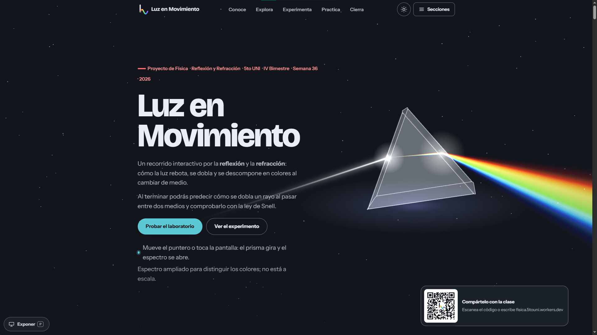
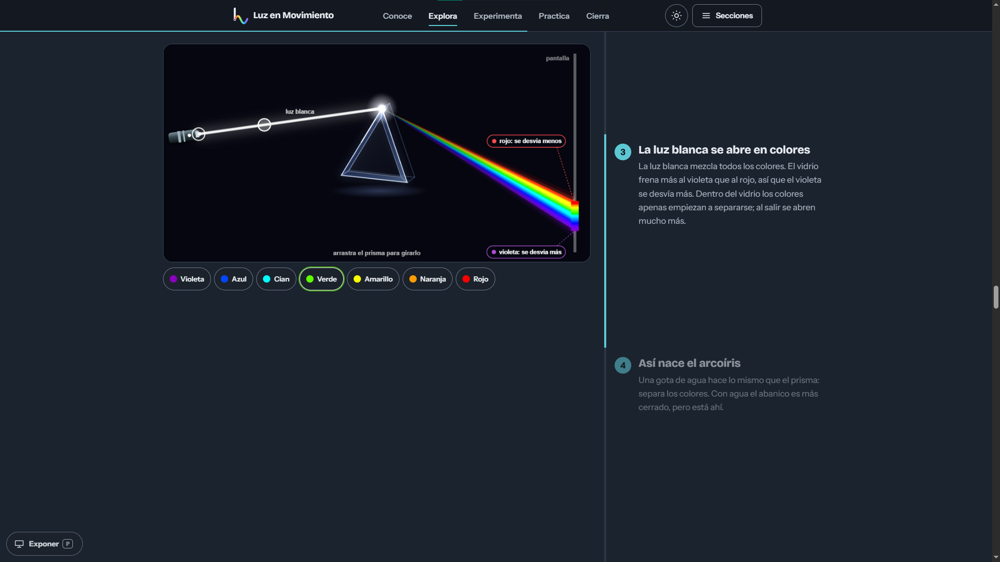
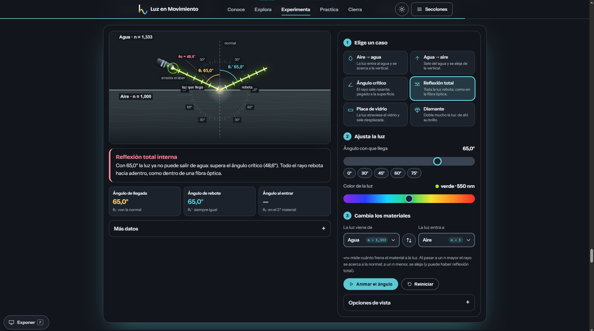

# Luz en Movimiento — Reflection and Refraction of Light

**Live site:** https://fisica.5touni.workers.dev

An interactive web project about the **reflection and refraction of light**, built for a high-school physics course
(5to UNI · Physics · 4th term). It is meant to be projected in class and shared as a link: students can open it on
their phones by scanning the QR code on the first screen.

> The interface is in Spanish (it is the audience's language). Code, comments, tests and documentation are in English.

## Screenshots

<p align="center">
  
</p>
<p align="center">
  
  
</p>

## Contents

- [Screenshots](#screenshots)
- [What it includes](#what-it-includes)
- [The three interactive tools](#the-three-interactive-tools)
- [Features](#features)
- [Tech stack](#tech-stack)
- [Getting started](#getting-started)
- [Configuration](#configuration)
- [Scripts](#scripts)
- [Project structure](#project-structure)
- [Editing the content](#editing-the-content)
- [Testing](#testing)
- [Deployment](#deployment)
- [Contributing](#contributing)
- [License](#license)

## What it includes

The page is one scrolling route, in this order (the menu, the footer and the presentation mode follow the same order):

| Section      | What the user can do                                                                                          |
| ------------ | ------------------------------------------------------------------------------------------------------------- |
| Home         | 3D glass prism that follows the pointer (2D fallback without WebGL), the learning goal, and a QR code (desktop only) to open the site            |
| Team         | Member cards with name and role                                                                               |
| History      | Vertical timeline from Plato (~400 BC) to Huygens with Reflection / Refraction filters and an animated figure per event |
| Key ideas    | Reflection, refraction and total internal reflection with animated ray diagrams, plus a comparison table      |
| Prism        | Scroll-driven story, draggable prism and laser, white-light dispersion, Newton's two-prism experiment         |
| Applications | Real-life uses (rainbow, optical fiber, mirages, lenses…)                                                     |
| Experiment   | Group setup viewer and virtual measuring practice                     |
| Free lab     | "Laboratorio libre": any medium, angle and color; critical angle, total internal reflection, glass slab          |
| Problems     | Three solved prism problems (10, 11 and 13) with the solution drawn step by step over the statement figure    |
| Conclusions  | Wrap-up of every section                                                                                      |
| References   | One list of consulted sources, each with an "open site" and a "copy citation" button                          |

The physics is deliberately kept at **high-school level**: Snell's law, refractive index, critical angle, total
internal reflection and color dispersion. No Fresnel equations, polarization or Brewster angle.

## The three interactive tools

The page has three different tools. A guide strip (`ToolGuide`) above each one repeats what it is for, so nobody mixes
them up. In short: the **setup** is for watching, the **practice** is for measuring, the **free lab** is for exploring.

| Tool                    | Where                     | Verb     | What it does                                                                                                                                                                                                                                                                                                    | What it is *not* for                                          |
| ----------------------- | ------------------------- | -------- | --------------------------------------------------------------------------------------------------------------------------------------------------------------------------------------------------------------------------------------------------------------------------------------------------------------- | ------------------------------------------------------------- |
| **Group setup**         | Experiment, first block   | Observe  | Animated model of the real experiment: a 2 L container, 1.8–2 L of water, 3–6 mL of milk and a red laser. Sliders for water, milk and laser angle show how the beam bends (θ₁, θ₂), how much light is reflected (θᵣ and the reflected %), and whether the milk amount makes the beam too faint or too cloudy. | Measuring or being graded: you only watch and understand.     |
| **Measuring practice**  | Experiment, second block  | Measure  | Virtual protractor. Choose θ₁, **read θ₂ on the protractor, type it** and press *Comprobar*; it grades your reading, computes **n = sen θ₁ ÷ sen θ₂** and the **percent error**, and keeps a score. A second mode, **mystery material**, computes n from your reading and you guess the material (water, glass, diamond). | Exploring other cases: only water and one mystery material.   |
| **Free lab**            | Free lab section          | Explore  | Free canvas: drag the laser, choose the first and second medium (air, water, glass, diamond…), the angle and the color of the light, or pick a ready-made case (air → water, water → air, critical angle, total internal reflection, glass slab, diamond). Plain-language readouts explain what happens.        | Following a procedure or getting a grade: it is for "what if…?" |

### Where the user enters data

- **Measuring practice** (virtual): the θ₂ text field. It accepts a dot or a comma and rejects values outside 2°–89°.
- Nothing else is typed or stored: the page keeps no data in the browser.

## Features

- **Theme:** light and dark. The page **follows the operating-system color scheme** (from the first paint, and live when
  the system switches); the toggle button overrides it until the system changes again.
- **Logo:** an "L with a wave" mark with no background, drawn in SVG; its neutral parts follow the text color, so it works
  in both themes. `public/logo.svg` and `public/favicon.svg` adapt through `prefers-color-scheme`.
- **Presentation mode** ("Exponer" button at the bottom left, or the `P` key): one full-screen slide per section. **Click (or tap) on empty
  space, or press `Space` / `Enter`, to show the next part and then the next slide** (`Shift+Space` / `Backspace` go back);
  `←` / `→` or `PageUp` / `PageDown` change slide, `Home` / `End` jump to the ends, `F` toggles fullscreen, `T` the timer and
  `Esc` leaves. On touch screens swipe left / right to change slide.
- Smooth, constant animation (respecting `prefers-reduced-motion`), compact navigation, touch-friendly controls.

## Tech stack

- **React 19** + **Vite 6** (JavaScript, JSX, no TypeScript)
- **motion** (Framer Motion) for UI animation
- **Three.js**, loaded lazily, only for the hero prism
- Canvas 2D for the prism lab and the free lab, SVG for diagrams, the virtual lab and the logo
- Plain CSS in layers (see [docs/ARCHITECTURE.md](docs/ARCHITECTURE.md))
- Tests with Node's built-in runner (`node:test`): no extra dev dependencies

## Getting started

Requires Node.js **20 or newer** (22 recommended) and npm.

```bash
npm install
npm run dev        # development server at http://localhost:5173
npm run build      # production build into dist/
npm run preview    # serve the production build locally
```

## Configuration

| Variable        | Default                             | Purpose                                                     |
| --------------- | ----------------------------------- | ----------------------------------------------------------- |
| `VITE_SITE_URL` | `https://fisica.5touni.workers.dev` | Public address shown in the hero and encoded in the QR code |

Copy `.env.example` to `.env` to override it. Only `VITE_`-prefixed variables reach the browser: never store secrets
there. Course data (classroom, week, term…) lives in `src/config/site.js`.

## Scripts

| Command          | What it does                                                                                              |
| ---------------- | --------------------------------------------------------------------------------------------------------- |
| `npm test`       | Runs the unit, content, architecture and renderer tests (`tests/`)                                        |
| `npm run check`  | Bundles the app in memory to catch syntax errors, unresolved imports and missing exports                  |
| `npm run verify` | `test` + `check` + `build`: run it before every commit or deploy                                          |

A single self-contained HTML file can be produced with `npx vite build -c vite.single.config.js` (output in `dist-single/`). If dependencies are unavailable, run `node tools/offline-build/build.mjs` for a fallback HTML file with a 2D hero.

## Project structure

```
src/
  main.jsx            entry point (providers + styles)
  App.jsx             page composition: section order must match content/navigation.js
  config/             deployment settings and constants (site URL, course data, palette)
  domain/             pure physics and rules: no React, no DOM  <- the core, fully unit-tested
  content/            editable text and data (history, theory, problems, team, references…)
  rendering/          canvas drawing as pure functions of (context, state), plus the free lab's scene model
  hooks/              reusable React hooks (theme, canvas loop, scroll, touch guard…)
  lib/                small browser utilities (canvas setup, clipboard, theme transition, vendored QR library)
  components/         shared presentational components (icons, diagrams, brand mark, UI primitives)
  features/<name>/    one folder per page section; features never import each other
  styles/             base.css -> theme.css -> features/*.css (see index.css for the load order)
public/               static files: favicon.svg, logo.svg, social-preview-2026.png, robots.txt, sitemap.xml
design/logos/         logo proposals and fixed-color variants of the active logo
tests/                node:test suites + a recording canvas context
scripts/              check-bundle.mjs
tools/offline-build/  offline single-file build fallback
docs/                 architecture, decision records, screenshots, license options
```

Dependency rule (enforced by `tests/architecture.test.js`):
`features -> hooks / rendering / components / content -> domain`. The `domain` layer imports nothing from the rest of
the project and never touches the browser.

See **[docs/ARCHITECTURE.md](docs/ARCHITECTURE.md)** for diagrams, module contracts and data flow, and
**[docs/DECISIONS.md](docs/DECISIONS.md)** for why things are the way they are.

## Editing the content

Nothing about the physics needs to change to edit the site; everything editable is in `src/content` and `src/config`:

| To change…                                           | Edit                                                                                      |
| ---------------------------------------------------- | ----------------------------------------------------------------------------------------- |
| Team members (name, role and optional photo path) | `src/content/team.js`                                                                     |
| Course info (classroom, week, term) and public URL   | `src/config/site.js` / `.env`                                                             |
| History timeline                                     | `src/content/history.js` (keep it chronological; exactly one event has `highlight: true`) |
| Key ideas, applications, conclusions                 | `theory.js`, `comparison.js`, `applications.js`, `conclusions.js`                         |
| References (one list)                                | `src/content/references.js`                                                               |
| Solved problems and the marks drawn over each figure | `src/content/problems.js`, `src/content/problemMarks.js`, images in `src/assets/problems/` |
| Experiment steps and materials                       | `src/content/experiment.js`                                                               |
| Virtual practice cards                               | `src/content/virtualLab.js`                                                               |
| What each of the three tools is for                  | `src/content/tools.js`                                                                    |
| Prism-lab story steps                                | `src/content/prismLab.js`                                                                 |
| Ready-made light-lab cases                           | `src/features/simulator/scenarios.js`                                                     |
| Logo in use                                          | `ACTIVE_LOGO` in `src/components/logoMarks.js`; static copies in `public/`                |

`npm test` validates the content (valid icons, chronological history, consistent navigation, correct problem answers…).

### Adding a new page section

1. Create `src/features/<name>/<Name>Section.jsx` that renders `<section id="<id>">`.
2. Add `{ id, label }` to `src/content/navigation.js` and the accent color `--h-<id>` in `src/styles/theme.css`.
3. Render it in `src/App.jsx` **in the same position** as in the navigation list.
4. Put its styles in `src/styles/features/<name>.css` and import it in `src/styles/index.css`.
5. Run `npm run verify`: the tests fail if the navigation, the sections or the dependency rules disagree.

## Testing

```bash
npm test
```

What is covered:

- **Physics** (`optics`, `rayTracing`, `prism`, `interfaceModel`): Snell's law, critical angles, total internal
  reflection boundaries, dispersion order, minimum deviation of a prism, Newton's recombination, slab lateral shift,
  no NaN/Infinity over the full angle range.
- **Experiments**: expected angles, input parsing, grading tolerances, and that the "mystery material" options stay distinguishable.
- **Content integrity**: navigation, sections and `App.jsx` order, history order, icon names, problem answers.
- **Renderers**: every medium pair, mode and transition state draws a balanced, finite frame (using a recording canvas context).
- **Architecture**: layering rules, no dead modules, no browser APIs in `domain`, English-only code comments.

Not covered automatically: real browser behavior (WebGL hero, touch gestures, fullscreen) and visual appearance.
Check those manually on a desktop and a phone before presenting.

## Deployment

`npm run build` produces a static site in `dist/` that can be hosted anywhere (Cloudflare Workers/Pages, Netlify,
Vercel, GitHub Pages). Set `VITE_SITE_URL` to the final address **before building** so the QR code points to it, then
scan the QR from a phone on mobile data to verify. `wrangler.jsonc` and `public/_headers` hold the Cloudflare settings.

## Contributing

1. Create a branch and keep changes small and focused.
2. Put physics in `src/domain` (with a test), text in `src/content`, drawing in `src/rendering`, UI in `src/features/<name>`.
3. **Write everything in English** (code, comments, tests, docs). Only text shown to users stays in Spanish.
4. Run `npm run verify` and check the page in a browser (desktop and phone) before opening a pull request.
5. Formatting: `.editorconfig` and `.prettierrc.json` describe the style (no semicolons, single quotes). Format only the files you touch.

## License

**No license has been chosen yet.** See [LICENSE](LICENSE) and [docs/LICENSE-DECISION.md](docs/LICENSE-DECISION.md).
Third-party software keeps its own licenses (React, Vite, motion, Three.js: MIT; `src/lib/qrcode.js`: MIT, © 2009 Kazuhiko Arase).
