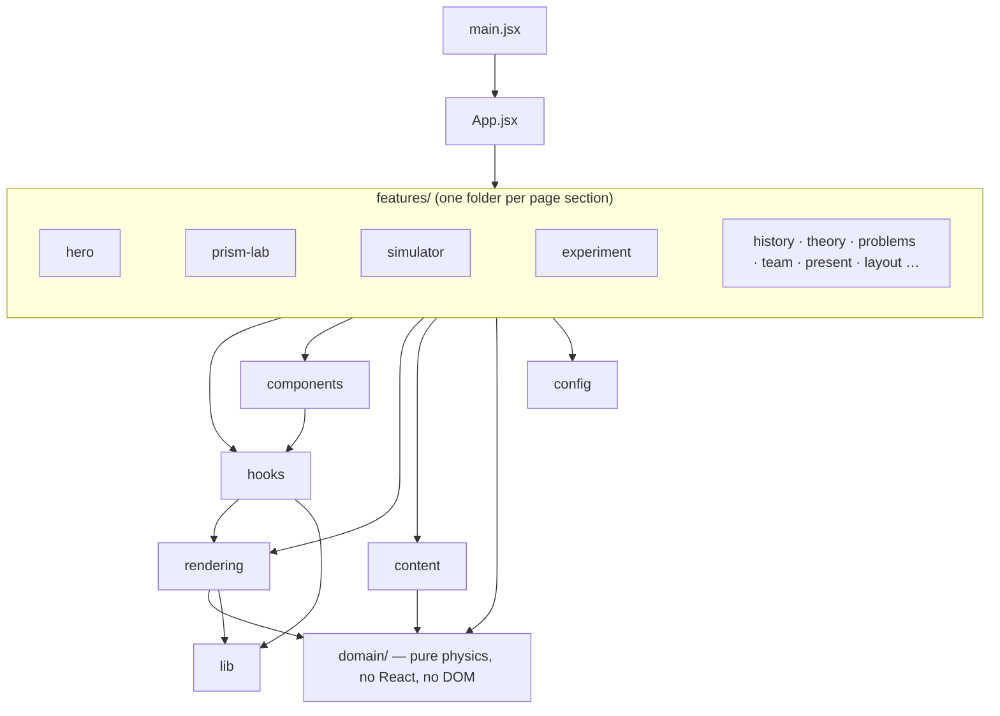
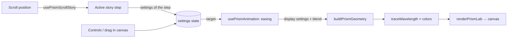

# Architecture

"Luz en Movimiento" is a **static single-page application** (React + Vite). It has no backend and needs none:
all the physics runs in the browser and the only persistence is `localStorage`. The architecture therefore optimizes for
what actually changes in this project: **content** (edited by students), **sections** (added over time) and **drawing code**
(the most intricate part), while keeping the **physics** isolated and testable.

## Layers and dependency rule



| Layer | Responsibility | May import |
|---|---|---|
| `domain` | Physics and rules as pure functions (Snell, ray tracing, prism, experiment grading) | nothing outside `domain` |
| `config` | Deployment settings (site URL, course data, palette) | nothing |
| `lib` | Small browser utilities (canvas setup, clipboard, theme transition, vendored QR) | nothing outside `lib` |
| `content` | Editable text and data | `domain` |
| `rendering` | Canvas drawing as pure functions of `(ctx, state)` + the simulator's scene model | `domain`, `lib` |
| `hooks` | Reusable React behavior | `domain`, `lib`, `rendering` |
| `components` | Shared presentational components | `domain`, `lib`, `hooks`, `config` |
| `features/<name>` | A page section: state, composition, interaction | all of the above; **never another feature** |
| `App.jsx` | Composition of sections | everything |

`tests/architecture.test.js` fails the build when an import violates this table, when a feature imports another
feature, when `domain` touches the browser, or when a module is dead.

## Why this shape

- **Physics must be trustworthy and cheap to test.** Everything in `domain/` is deterministic, so the whole suite runs in
  Node in milliseconds, with no browser and no mocks.
- **Drawing is the riskiest code to change blindly.** Renderers are pure functions of `(ctx, state)`; tests run them with
  a recording context and check invariants (balanced `save/restore`, finite coordinates). During the refactoring the same
  recording technique proved the new renderers issued *exactly the same* draw calls as the old ones.
- **Sections evolve independently.** A feature owns its state and talks to the rest only through `domain`, `content`
  and shared components, so adding, removing or rewriting a section touches one folder plus one line in `App.jsx`.

## Module map

```
domain/
  constants.js        speed of light, reference wavelength, default dispersion
  media.js            optical media (MEDIA, INDEX) and prism materials
  units.js            toRadians / toDegrees
  numbers.js          parseDecimal, percentError, clamp
  optics.js           effectiveIndex, applySnellLaw, refractDirection, criticalAngleDegrees, slabLateralShift…
  spectrum.js         wavelength → RGB / CSS color / Spanish color name
  rayTracing.js       traceThroughPolygons, pointInPolygon
  prism.js            prism geometry, per-wavelength tracing, comfortable rotation, color recombination
  interfaceModel.js   physics of a ray at a boundary or through a slab
  experiment.js       result rows, average index, TSV/CSV export for the real experiment
  virtualLab.js       reading validation and grading rules of the virtual lab
rendering/
  laser.js            drawBeam / drawLaser (canvas; SVG twin in components/LaserSvg.jsx)
  simulatorModel.js   scene → physics + ray layout (shared by renderer and feature)
  simulatorRenderer.js, prismLabRenderer.js, heroFallbackRenderer.js, palette.js
features/prism-lab/   PrismLabSection (state/layout) · PrismCanvas (pointer input) · usePrismAnimation (easing loop)
                      usePrismScrollStory (scroll → step) · interaction.js (hit testing / drag → settings)
features/simulator/   SimulatorSection (state) · SimulatorCanvas · ControlPanel · Readouts · scenarios · explanation
features/experiment/  ExperimentSection · VirtualLab (+ useVirtualLab, ProtractorFigure) · ResultsTable · StepChecklist · PhotoGallery
features/hero/        Hero · Hero3D (React wrapper) · heroScene (Three.js) · heroBeam (optics) · Hero2DFallback · JoinCard
features/present/     PresentBar + hooks: slides, fullscreen, idle timeout, timer, keyboard
```

## Contracts between modules

These are the interfaces other modules rely on. Changing them means updating callers and tests.

**Domain (pure; angles in degrees unless the name says `Angle` for radians)**

| Function | Contract |
|---|---|
| `applySnellLaw(n1, n2, incidentRad)` | `{ totalInternalReflection, refractedAngle(rad) }`; refracted angle is π/2 under total internal reflection |
| `refractedAngleDegrees(n1, n2, incidentDeg)` | degrees, or `null` under total internal reflection |
| `effectiveIndex(n0, nm, dispersive, k)` | `n0` at 550 nm; grows as the wavelength shortens |
| `traceThroughPolygons(polygons, glassIndex, origin, direction)` | `{ points, direction, exitAngle }`, at most 8 surface interactions; `exitAngle` is `null` if the ray never leaves |
| `buildPrismGeometry(settings)` | `{ center, polygons }` (1 prism, or 2 with `newtonPair`) in lab pixels |
| `traceWavelength(settings, nm, geometry)` | trace + `{ index, deviation }` |
| `solveInterface(scene)` | `{ n1, n2, incident, totalInternalReflection, refractedAngle, refractedDegrees, criticalDegrees, lateralShiftCm }` |
| `buildResultRows(rawReadings)` | one row per incidence angle; invalid readings produce rows without `index`/`errorPercent` |

**Rendering**

| Function | Contract |
|---|---|
| `renderSimulator(ctx, scene, model, { time, palette, rayColor, scale })` | draws one full frame in 900×460 logical pixels; leaves `save/restore` balanced |
| `renderPrismLab(ctx, settings, geometry, selectedNm, blend, { time, scale })` | one frame; `blend = { prismOpacity, pairOpacity, whiteMix }` (0–1) cross-fades state changes |
| `drawHeroFallback(ctx, size, pointer, time, dark)` | 2D hero used without WebGL |

**Content** modules export plain data (arrays/objects). `NAV_ITEMS` order = order of sections in `App.jsx`.

## Main data flows

**Prism lab (a frame):**



**Simulator:** `scene (state) → buildSimulatorModel → { physics, ray layout } → renderSimulator` on every animation
frame, and `→ explainScene / Readouts` for text. The control panel and the canvas both report changes upward; only
`SimulatorSection` owns the scene.

**Presentation mode:** `usePresentationSlides` marks one `<main>` section with `.expo-cur`; CSS (`styles/features/present.css`)
shows only that section, full screen. Every section works unchanged inside a slide.

## Cross-cutting concerns

- **Accessibility:** WAI-ARIA tabs (theory, history), `role="switch"` toggles, `aria-live` for results, keyboard control
  of the simulator (arrows, Shift for bigger steps), skip link, focus handling in presentation mode.
- **Motion:** every animation honors `prefers-reduced-motion` (CSS, motion's `MotionConfig`, and the canvas loops).
- **Touch:** canvases never trap page scrolling; `useTouchGuard` blocks scroll only when a handle is grabbed.
- **Persistence:** `useStoredState` wraps `localStorage` (`luz.steps`, `luz.meas`, `luz.problems`). Failures fall back to
  memory. The problems store accepts both the current and the legacy field names.
- **Performance:** Three.js is a lazy chunk; animations pause off-screen (hero scene, prism lab); the canvas pixel ratio is capped at 2.
- **Security:** no secrets, no network calls apart from Google Fonts in `index.html`; the only runtime configuration
  is the public `VITE_SITE_URL`.

## Styles

`src/styles/index.css` fixes the load order: `base.css` (reset, tokens, original component styles) → `theme.css`
(the visual layer that overrides it) → `features/*.css` → `features/present.css` last (it overrides other sections
while presenting). The feature files are independent of each other, so their relative order is free. Class names
are global; keep selectors prefixed by their feature's root class.

## Known limitations

- Visual and browser behavior (WebGL, touch gestures, fullscreen) is not covered by automated tests.
- `base.css` and `theme.css` still contain feature-specific rules from before the split; moving them into
  `features/` is possible but needs visual regression testing first.
- Fonts come from Google Fonts (`index.html`); self-hosting them would remove the only third-party request.
